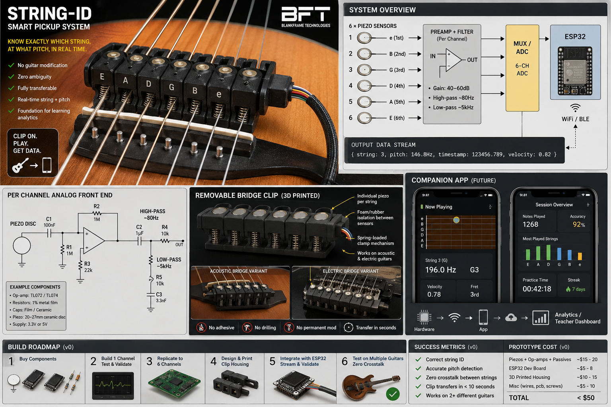
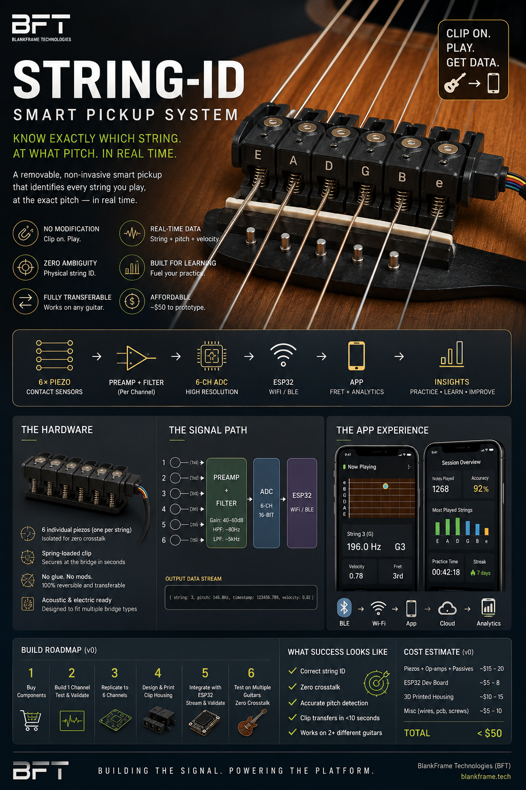
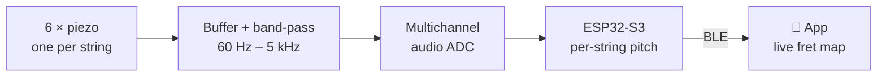

# FretGPS

**A positioning system for your fretboard.** You play, and your phone shows which string and fret every note came from, how far you bent it, and which strings you muted, as a live animated fret map.



> Status (2026-10-24): idea stage. The phone-only experiment works and has been measured. Hardware has not been started. The plan, with exit criteria for each phase, is in **[docs/PLAN.md](docs/PLAN.md)**.

## The idea in 30 seconds

**Audio knows the pitch, not the place.** On a guitar, the same E4 can be played in five spots (e 0, B 5, G 9, D 14, A 19). Every tuner, tab app and learning app has to guess which one you used.

**FretGPS measures the place.** A removable clip at the bridge holds one sensor per string. Each string gets its own channel, so the string is measured instead of guessed. The pitch on that channel gives the fret, and the pitch curve gives the bend.

**The output is one frame of a fret map per moment:**

```
 t = 12.48 s       0   1   2   3   4   5   6   7
 1  e   ‖───┼───┼───┼───┼───┼───┼───┼───
 2  B   ‖───┼───┼───┼───┼───┼───┼───┼───
 3  G   ‖───┼───┼───┼───┼───┼─●─┼───┼───    C4, bending +100¢ → C♯4
 4  D   ‖───┼───┼───┼───┼───┼───┼───┼───
 5  A   ✕                                    muted
 6  E   ✕                                    muted
```

…which comes from a stream of note events that every sensing source emits in the same shape:

```json
{"t": 12.48, "dur": 0.31, "string": 3, "fret": 5, "note": "C4", "hz": 261.6, "bend_cents": 100}
```

## Can we skip the hardware? (Phase 0)

We tested whether a plain recording, with only the guitar in it, can produce the fret map. The prototype is [`experiments/phone-audio/fretmap.py`](experiments/phone-audio/fretmap.py). It was scored against [GuitarSet](https://zenodo.org/records/3371780): 360 real acoustic-guitar recordings with the true string and fret of every note.

| Question | Result |
|---|---|
| Which notes? | **82%** of single notes and **71%** of chord notes found (note F1 with Basic Pitch). The hand-written pYIN tracker gets 68% on the mic and 64% on a simulated phone |
| Which string, with perfect pitches? | **43%** on lead lines and 72% on chords with a least-hand-movement rule. Showing every note on its lowest fret, like a tuner app, gets 31% |
| …plus "I'm around fret N" | **79%** with one hint per take · **89%** with a rolling hint (what a camera could see). Both use ideal hints, so they are upper bounds |
| Bends | ✅ measured in cents from the pitch curve |
| Muted strings | ❌ not from audio |


**Verdict:** a phone gets you the notes and the bends, but only guesses the string. The string guess is mostly a "where is the hand" problem: one rough position hint nearly doubles accuracy. That gives three tiers worth building in this order:

1. **Phone only** (free): notes, bends, replay.
2. **Phone + a position hint**: you tap the neck, the camera watches your hand, or a few-dollar distance sensor sits on the headstock. Test this next.
3. **The String-ID clip**: muting, exactly which strings rang, and a ≥ 95% string ID.

Full write-up, recording protocol and next experiments: **[docs/phone-audio-experiment.md](docs/phone-audio-experiment.md)**.

## The hardware concept: String-ID clip





- **No modification:** it clips onto the bridge, no drilling or glue, and moves between guitars.
- **String identity happens before pitch.** Each channel only has to track one string, so chords come out as six easy monophonic problems instead of one hard polyphonic one.
- **Muting becomes visible:** a muted string's channel goes quiet.

The concept art gets a few things wrong: the discs are wider than the string spacing, the preamp can't run on 3.3 V, the ADC choices are too slow, and the app mock shows the wrong fret. [PLAN.md §6 and §8](docs/PLAN.md#6-hardware-v0-the-concept-art-corrected) has the corrections.

## Roadmap

| Phase | What | Status |
|---|---|---|
| 0 | Phone only: audio → notes → string and fret guess | ✅ prototype + measurement · ⏭ test on your own recordings |
| 0b | Real position hints: your "around N", phone camera, headstock distance sensor | ⬜ next |
| 1 | One piezo on the bench (the disc you already have) | ⬜ |
| 2 | Two-channel crosstalk go/no-go | ⬜ |
| 3 | Six-channel clip + ESP32-S3 + BLE event stream | ⬜ |
| 4 | App: live fret map, bend meter, mute markers, replay, tab export | ⬜ can start now on phone-audio events |

Parked until Phase 3 passes: the capacitive fretboard overlay, teacher dashboard, AI coach, analytics and cloud. See [PLAN.md §5](docs/PLAN.md#5-roadmap-and-exit-criteria).

## Try the phone-only prototype

```bash
cd experiments/phone-audio
python3.11 -m venv .venv && source .venv/bin/activate
pip install -r requirements.txt          # also needs ffmpeg (brew install ffmpeg)
python test_fretmap.py                    # self-check on a synthesized riff
python fretmap.py ~/Downloads/riff.m4a    # any phone recording → ASCII tab
python fretmap.py ~/Downloads/riff.m4a --around 7   # tell it roughly where your hand is
python fretmap.py ~/Downloads/riff.m4a --json
```

## Repo layout

```
docs/
  PLAN.md                     product plan: scope, roadmap, exit criteria, risks, BOM corrections
  phone-audio-experiment.md   can a phone recording replace the hardware? (results + feedback)
  images/                     concept art + the measured fret-map figure
experiments/phone-audio/
  fretmap.py                  recording → notes → (string, fret) → tab / JSON events
  test_fretmap.py             synthesized-riff self-check (pitch, repeated notes, bend, chord)
  eval_guitarset.py           scores fretmap on GuitarSet
  plot_example.py             draws docs/images/fretmap-example.png
```
