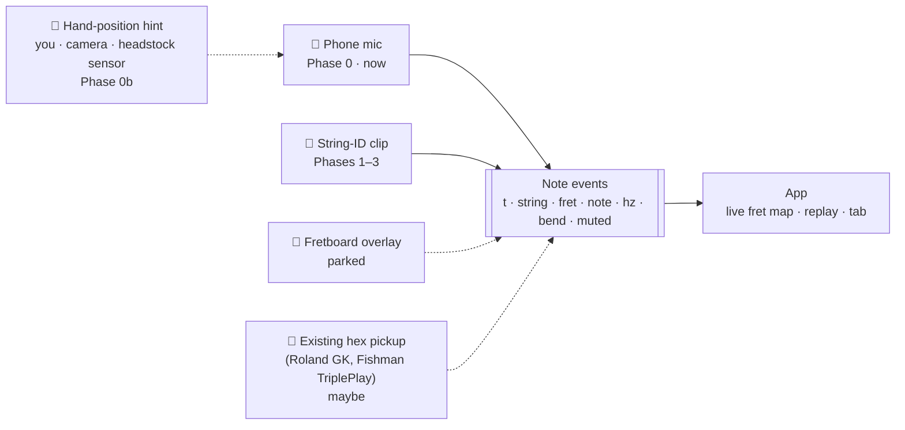
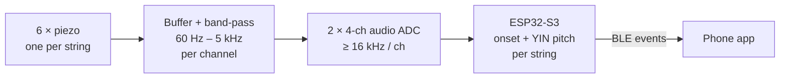

# FretGPS project plan

Status on 2026-10-24: idea stage. Phase 0 (phone only, no hardware) has a working prototype and a first measurement. See [phone-audio-experiment.md](phone-audio-experiment.md). The headline: audio gets the notes and bends, guesses the string (43%), and a rough hand-position hint lifts that to 79–89%.

## 1. The pitch

Play your guitar and your phone shows where every note was played: string, fret, how far you bent it, which strings you muted. It appears as a live fret map, and you can replay it later.

"GPS" is a metaphor: a positioning system for the fretboard. There is no GPS module. Earlier notes treated location tracking as an adjacent idea. That is out of scope.

## 2. The problem

Audio tells you the pitch. It does not tell you where on the neck the note was played. On a 20-fret guitar in standard tuning, most pitches can be played in two to five places:

| Pitch | Where it can be played |
|---|---|
| E4 (329.6 Hz) | e 0 · B 5 · G 9 · D 14 · A 19 |
| C4 (261.6 Hz) | B 1 · G 5 · D 10 · A 15 · E 20 |
| A2 (110 Hz) | A 0 · E 5 |

Tuner apps, learning apps and audio-to-tab tools all have to guess the position. FretGPS is a bet that we can measure it instead.

**Who it is for:** the first user is the builder, a player who wants to see what they actually played. Next come learners and teachers (the Smart Fretboard notes) and creators who want tabs without typing them.

## 3. What the fret map needs, and who can supply it

There are four ways to sense the guitar. The two phone columns are measured on GuitarSet (see the experiment doc); the hint figures use an ideal hint, so they are upper bounds. The last two columns are expectations to test.

| Signal | Phone mic only | Phone mic + hand-position hint (you, the camera, or a headstock sensor) | String-ID clip (one piezo per string) | Fretboard overlay (capacitive sleeve) |
|---|---|---|---|---|
| Which note (pitch) | ✅ 82% F1 single notes · ⚠️ 71% chords | same | ✅ each string's channel is monophonic | ❌ needs audio as well |
| Which string | ❌ guessed: **43% right on solos even with perfect pitch** | ⚠️ **79% (one hint per take) to 89% (rolling hint)** | ✅ measured | ✅ measured |
| Which fret | ⚠️ follows the string guess | ⚠️ follows the string | ✅ string + pitch | ✅ |
| Chords: which strings rang | ⚠️ notes partly, strings guessed | ⚠️ 81–87% placed right | ✅ | ⚠️ knows the fingers, not what rang |
| Bend amount (cents) | ✅ from the pitch curve | ✅ | ✅ | ❌ |
| Muted strings | ❌ only "the note stopped" | ❌ | ✅ the channel's energy collapses | ⚠️ |
| Fingering (which finger) | ❌ | ⚠️ camera only | ❌ | ✅ |
| Fits any guitar without mods | ✅ | ✅ | ✅ (the clip has to fit the bridge) | ⚠️ the sleeve must fit each neck |
| Hardware cost | $0 | $0 (camera) to a few dollars (distance sensor) | about $40–70 in parts | unknown, high |

**Reading:** the phone already does pitch and bends well. The string is the hard part, and the experiment shows it is mostly a "where is the hand, roughly" problem. A cheap position hint should get most of the way there. Only per-string sensing gives muting, exactly which strings rang, and a ≥ 95% string ID. So: the phone, plus a hint, is the free/cheap tier, and the String-ID clip is the premium tier.

## 4. Decision: one event format, several sources

The app should not care where the events come from. Build it now against the free source (the phone mic), then swap in the hardware when it exists.



The contract is one JSON object per note. Strings are numbered the way guitarists number them: 1 = high e, 6 = low E. `experiments/phone-audio/fretmap.py --json` already emits it:

```json
{"t": 12.48, "dur": 0.31, "string": 3, "fret": 5, "note": "C4", "hz": 261.6, "bend_cents": 100}
```

The hardware adds `"muted": [5, 6]` (strings silenced at this moment) and `"velocity": 0.82`.

## 5. Roadmap and exit criteria

Every phase ends with a measurement, not a demo.

| Phase | What | Size | Exit criterion |
|---|---|---|---|
| **0. Phone only** | `fretmap.py` + GuitarSet eval ✅ · record your own clips (protocol in the experiment doc) | 1 weekend | Note F1 ≥ 80% on single-note lines from your phone, with `--around` measured on your own riffs |
| **0b. Position hint** | Real hints instead of ideal ones: your "around N" · phone camera + hand tracking · one time-of-flight distance sensor on the headstock | 1–2 weekends | Right string ≥ 85% on your riffs. **If it gets there, the cheap tier is real.** Either way the String-ID clip stays the premium path |
| **1. One channel on the bench** | The piezo disc you already have → rail-to-rail op-amp buffer → ESP32-S3 ADC at ≥ 16 kHz → serial → the same pitch tracker on the laptop | 1 weekend | Clean pitch on all six open strings and the 12th fret from one sensor. Measure the real signal level, then set the gain |
| **2. Crosstalk go/no-go** | Two sensors on adjacent strings, in a printed clip with foam between them | 1 weekend | **Go** if, on every adjacent pair, the plucked channel is ≥ 12 dB above its neighbour at the attack. **No-go** → better isolation, smaller elements, or a magnetic hex pickup instead |
| **3. Six-channel clip + BLE** | 6 channels, a multichannel audio ADC, per-string pitch on the ESP32, events over BLE | 2–4 weeks | ≥ 95% string + fret on single notes and slow chords · ≤ 50 ms from pluck to screen · the clip moves between 2 guitars in < 10 s |
| **4. App v1** (runs alongside 0–3) | Live fret-map animation, bend meter, mute markers, replay, tab export | 2–3 weeks | You use it in a real practice session and the replay matches what you played |

**Parked** until Phase 3 passes, because each one assumes the event stream is already right: the capacitive fretboard overlay, teacher dashboard, AI coach, practice analytics, cloud sync, subscriptions, MIDI-controller mode, and GPS/location.

## 6. Hardware v0: the concept art, corrected

| Part | Concept art says | Change to | Why |
|---|---|---|---|
| Sensors | 6 × 20–27 mm piezo discs side by side | Smaller elements, or discs staggered in two rows, or a small contact "finger" per string that carries vibration to a disc set further back | Strings are ~10.5 mm apart at the bridge (~55 mm from E to e), so six 27 mm discs do not fit in a row |
| Preamp | TL072, 40–60 dB | A rail-to-rail CMOS op-amp (e.g. MCP6004, a quad that runs on 1.8–6 V), ≥ 1 MΩ input, biased at mid-rail. Set the gain after Phase 1 | The TL072 isn't rated for a 3.3 V supply. A piezo under string tension can give hundreds of mV, so 40–60 dB would likely clip. Its real problem is impedance, not level |
| High-pass | ~80 Hz | ~60 Hz | Low E is 82.4 Hz (drop D is 73.4 Hz). An 80 Hz corner cuts the fundamental |
| Low-pass | optional ~5 kHz | Required: the anti-alias filter, matched to the sample rate | |
| ADC | ESP32 ADC, ADS1115 or ADS1256 | ESP32-S3 ADC in continuous (DMA) mode for Phases 1–2. Two 4-channel audio ADCs (e.g. ES7210 or TLV320ADC6140) for Phase 3 | The ADS1115 tops out at 860 samples/s, far too slow for audio. The ADS1256 shares 30 kSPS across its multiplexer and loses more to settling time |
| MCU | ESP32 | ESP32-S3 | More ADC and DSP headroom, BLE 5. Compute pitch on the device: raw 6 × 16 kHz × 16-bit audio is ~1.5 Mbit/s, more than BLE carries reliably |
| Power | 100–300 mAh LiPo, USB-C | keep | Measure the current draw in Phase 3 |
| Housing | 3D-printed PLA/PETG spring clip | keep, but **design for one guitar first** | Pin bridges, tune-o-matics, Strat tremolos and Floyds all need different clips |
| Cost | "< $50" (an earlier chat also said $250) | Budget ~$60–100 for the first build, spares included | It's a budget, not a quote |

Signal path for Phase 3:



## 7. Risks, ranked

1. **Crosstalk through the bridge.** All six sensors sit on one vibrating bridge. Phase 2 is the go/no-go test. The "70–80% reduction" and "90% effective" figures in the earlier chat are guesses, not measurements.
2. **Sympathetic ringing.** Unplayed strings vibrate and look like faint notes. Use a threshold relative to the attack. The upside is that "this string is ringing when it shouldn't" becomes a feature for teaching muting.
3. **Physical fit.** Six sensors in 55 mm, across very different bridges. Pick one guitar.
4. **The clip changes the guitar.** Measure sustain and tone with and without it.
5. **Real-time pitch for 6 channels on the ESP32.** YIN on short windows per channel should fit on the S3. Check it in Phase 3.
6. **Prior art.** Hex pickups already sense each string separately: Roland GK, Fishman TriplePlay, Graph Tech ghost piezo saddles with the Hexpander. FretGPS has to win on being a removable clip, on working with acoustics, and on the fret-map app. Those pickups could also become a cheap event source for the app.
7. **"Phone only" might be good enough** for many players. That's fine: it becomes the free tier and the hardware is the upgrade.

## 8. Fixes to the concept art and earlier notes

- **App mockup:** "String 3 (G) · 196.0 Hz · fret 3rd" is wrong. 196 Hz on the G string is the open string. The 3rd fret is 233.1 Hz (A♯3).
- **Data-stream example:** `{string: 3, pitch: 146.8Hz}` cannot happen. 146.8 Hz is D3, which is below the G string's open pitch. Number strings 1 = high e … 6 = low E everywhere.
- **"Zero crosstalk"** as a success metric → "≥ 12 dB separation between adjacent strings" (Phase 2).
- **Disc size:** the notes say "35 mm" in one place and "20–27 mm" in another, and neither fits in a row (see section 6).
- **Schematic:** the op-amp input is referenced to ground. On a single 3.3 V supply it has to sit at mid-rail.
- **Muting** is only measurable with per-string sensing. No phone-only method will report "string 5 muted".

## 9. Open questions (your call)

1. **First guitar: acoustic or electric?** This decides the clip geometry, and whether a magnetic hex pickup is an option.
2. **Live first, or replay first?** Replaying a recording is much easier. Live needs the whole pipeline to run under ~50 ms.
3. **App stack:** Flutter, like Protiti, ThrottleIQ and PotholeAlertBD?
4. **Goal:** your own practice tool, or a product for learners and teachers? Everything after Phase 3 depends on the answer.
