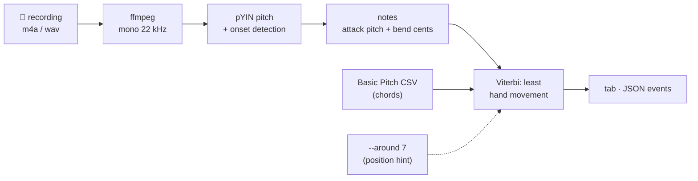
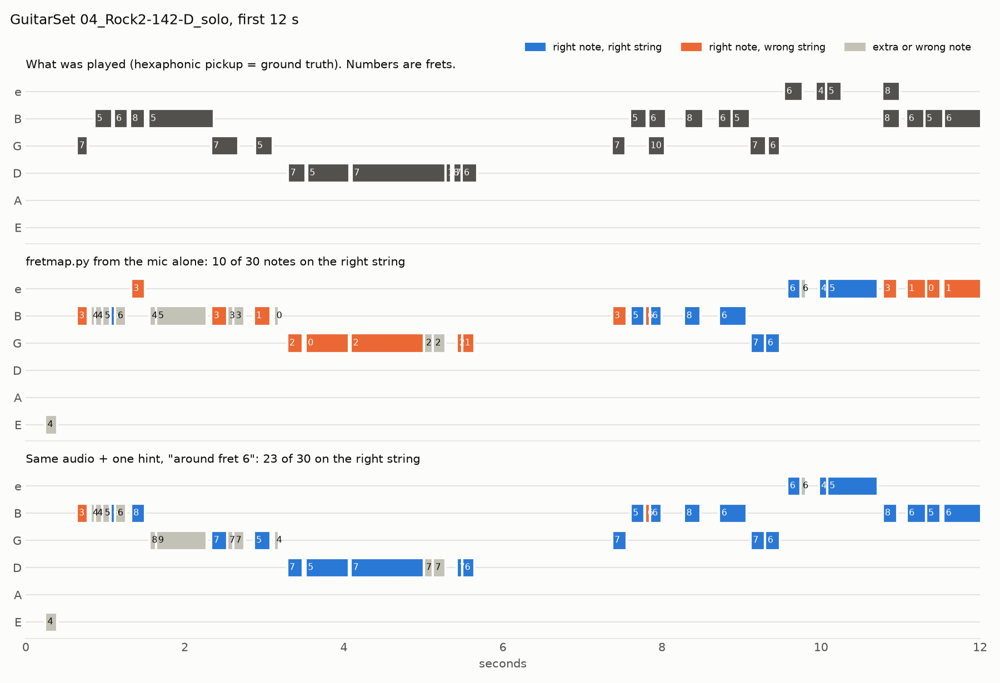

# Can a phone recording replace the hardware?

**Question:** record only the guitar on a phone, analyse the frequencies, and get the fret map (which string, which fret, bends, mutes) with no FretGPS hardware. Is that possible?

**Short answer:** half of it is.

- **Which notes you played:** mostly. 82% of single notes and 71% of chord notes are found.
- **How far you bent:** yes.
- **Which string and fret:** no, audio alone guesses. Only 43% land on the right string in lead lines, even with perfect pitches.
- **Which strings you muted:** no.

The surprise is that the string problem is really a "where is the hand, roughly" problem. Tell the software "I'm around fret 7" and right-string placement jumps from 43% to 79%. A rolling hand-position estimate takes it to 89%. Both figures use an ideal hint, so treat them as upper bounds. That makes a much cheaper hardware path worth testing before six piezos.

## What was built

[`experiments/phone-audio/fretmap.py`](../experiments/phone-audio/fretmap.py) is about 150 lines of Python:



- **Notes:** pYIN tracks the pitch every 11.6 ms. A new note starts at an attack, after silence, or when the pitch jumps by more than 0.7 semitone within one frame (hammer-ons, pull-offs, slide steps).
- **Bends:** the fret comes from the pitch at the attack. A smooth rise after the attack is a bend, measured in cents, not a new fret. This is how the fret map can tell "7th fret bent a whole step" from "9th fret".
- **String and fret:** audio can't say which string played a pitch, so `assign()` picks the sequence of positions that moves the fretting hand the least (Viterbi over every playable string/fret, chords kept within a 4-fret span). `--around N` pulls that path toward fret N.
- **Chords:** pYIN only follows one pitch at a time. For chords, `fretmap.py` also accepts the note-events CSV from [Basic Pitch](https://github.com/spotify/basic-pitch), Spotify's open polyphonic transcription model.

## How it was tested

There is no recording of your guitar yet, so the test data is **[GuitarSet](https://zenodo.org/records/3371780)** (Xi et al., ISMIR 2018, CC BY 4.0). It has 360 excerpts of about 30 s each, played on an acoustic guitar by 6 players in 5 styles. Every excerpt has a single-note **solo** and a chord **comp** version, recorded with a mic in a room. The true string and fret of every note come from a hexaphonic pickup, which is the same idea as the String-ID clip.

- A note counts as found when the pitch matches and the onset is within 50 ms (the usual transcription tolerance).
- **Phone simulation:** the mic audio with everything under 120 Hz rolled off, then squeezed through 64 kbps AAC. That is a cheap phone recording, roughly.
- **Hints are ideal:** they come from the ground truth (the take's median fret, or the median fret within ±2 s). A real "around 7" from you, or an estimate from a camera, will be noisier, so read those rows as upper bounds.
- Reproduce: `python eval_guitarset.py GUITARSET_DIR [--audio [--phone] | --notes BASIC_PITCH_DIR] [--around]`

## Results

### 1. Which notes were played?

| Note detector | Audio | Solo: precision / recall / **F1** | Comp (chords): precision / recall / **F1** |
|---|---|---|---|
| pYIN (`fretmap.py` default) | studio mic | 61.6% / 75.1% / **67.7%** | n/a (follows one pitch at a time) |
| pYIN | phone simulation | 58.0% / 71.6% / **64.1%** | n/a |
| Basic Pitch | studio mic | 79.0% / 84.9% / **81.8%** | 72.8% / 69.0% / **70.9%** |

### 2. Which string?

The share of notes placed on the right string. With true pitches every note counts; end to end, only the notes that were found count.

| Placement | Solo | Comp |
|---|---|---|
| *With true pitches (placement only)* | | |
| Lowest fret (what a tuner app would show) | 31.0% | 50.7% |
| `fretmap`: least hand movement | **43.4%** | 71.9% |
| + one hint per take ("around fret N") | **79.3%** | 80.8% |
| + rolling hint (where the hand is over ±2 s, like a camera would see) | **88.6%** | 87.0% |
| *End to end, from audio* | | |
| pYIN → `fretmap` (mic / phone sim) | 39.4% / 39.6% | n/a |
| pYIN → `fretmap --around` | 81.0% | n/a |
| Basic Pitch → `fretmap` | 39.9% | 64.1% |
| Basic Pitch → `fretmap --around` | 76.9% | 76.9% |
| *For reference* | | |
| TabCNN, a CNN trained on GuitarSet (other players, same guitar), from the literature | ~90% of found pitches | |



## What this means

1. **Notes are usable, but use a learned model.** Basic Pitch beats the hand-written pYIN pipeline even on single-note lines (82% vs 68% F1). In a sample of 36 solo takes, pYIN's extra notes are mostly a held note cut in two (44%). Also, 26% of "solo" notes overlap another note (double-stops, notes left ringing), which a one-pitch tracker can't follow. Octave errors are rare (5%).
2. **The phone itself is not the bottleneck.** Losing the bass under 120 Hz and the AAC compression cost 3.6 points of note F1 and nothing in string accuracy.
3. **Audio alone guesses the string, and the guesses are systematically wrong.** Per take, right-string placement ranged from 4% to 75% (36-take sample). When the guess is wrong, the whole line gets moved to another position on the neck: the shape is right and the place is wrong. Smarter movement rules didn't help: a hand-window model scored 35–43% over seven settings.
4. **One number fixes most of it.** Knowing roughly where the hand is (one "around fret N" per take) nearly doubles right-string placement, from 43% to 79%. A hand position that updates as you move gets 89%. That is close to TabCNN's ~90%, without any training.
5. **Learned timbre models don't travel.** TabCNN reaches ~90% when tested on the same guitar and mic it trained on. Pedroza et al. (DAFx 2024) show it degrading on other guitars and tones. A phone-only string ID would have to be calibrated per guitar.

## The verdict, signal by signal

| What you want on the fret map | From a phone recording alone? |
|---|---|
| Which notes, single-note lines | ✅ **Mostly:** 82% F1 with Basic Pitch on a good mic. Expect a bit less on a phone |
| Which notes, chords | ⚠️ **Partly:** 71% F1. Fast strums and let-ring chords blur |
| Which string / fret | ❌ **A guess:** 43% on solos even with perfect pitches · ⚠️ **79–89% with a hand-position hint** |
| Bend amount in cents | ✅ Straight from the pitch curve (checked on a synthesized whole-step bend) |
| Vibrato, slides, hammer-ons | ⚠️ Visible in the pitch curve. Not labelled yet |
| Which strings are muted | ❌ Audio only shows that a note stopped, not which string was silenced |
| Live (while you play) | ⚠️ Single notes, yes: tuner apps already track pitch in real time. The prototype is offline (whole file) |

## Feedback

1. **Build the phone-only version: it's the free tier and the app's first data source.** Notes, bends and replay work without hardware. Build the fret-map app against `fretmap.py --json` now. Nothing in the app changes when hardware arrives.
2. **Put a position control in the app from day one.** A slider or a tap on the neck ("I'm around here") is the cheapest feature with the biggest measured effect: 43% → 79% right string (ideal hint).
3. **Test a hand-position sensor before six piezos.** If a rolling position estimate really gives ~89%, the cheapest hardware is not six sensors under the strings but one sensor that sees the fretting hand:
   - **The phone camera** on a stand, aimed at the neck, with a hand-tracking model. No hardware at all.
   - **One distance sensor on the headstock** (a time-of-flight sensor like the VL53L1X costs a few dollars), aimed down the neck to measure how far away the hand is. Frets 5–12 are 2–3 cm apart, so it needs roughly 2 cm accuracy. Testing that is the experiment.
4. **The String-ID clip still owns what audio never gets:** muting, exactly which strings rang in a chord, and ≥ 95% string ID. It becomes the premium tier instead of the only way to get any fret map.
5. **Muting and chords-per-string are hardware-only.** Don't promise them in the phone tier.

## Record these on your guitar (≈ 15 minutes)

Use a quiet room with the phone 30–50 cm from the soundhole or amp. Turn off any "enhance" or noise-suppression setting, and use lossless or high quality if the app offers it. Save the clips in `recordings/`, which git ignores.

| Clip | Play | It tests |
|---|---|---|
| `01-open.m4a` | Each open string 3 times, low E to high e | Low-E pickup on a phone mic, onsets |
| `02-chromatic-g.m4a` | G string, frets 0 → 12 and back | Pitch → fret on one string |
| `03-same-note.m4a` | E4 four ways: e 0, B 5, G 9, D 14 | **The ambiguity.** Run it with and without `--around` |
| `04-bends.m4a` | G 7: half-step bend, whole-step bend, vibrato | Bend cents vs the fret |
| `05-riff.m4a` + its tab | Any riff you know | End to end: compare the tab with what you played |

```bash
python fretmap.py recordings/05-riff.m4a                 # audio only
python fretmap.py recordings/05-riff.m4a --around 7      # with a position hint
python fretmap.py recordings/04-bends.m4a --json
# chords: Basic Pitch first (Python 3.11: pip install basic-pitch onnxruntime "setuptools<81")
ffmpeg -i recordings/05-riff.m4a recordings/05-riff.wav
basic-pitch recordings/ recordings/05-riff.wav --save-note-events --model-serialization onnx
python fretmap.py recordings/05-riff_basic_pitch.csv
```

## Limits of this experiment

- GuitarSet is a good studio mic on one acoustic guitar. A real phone, an electric guitar through an amp, or a noisy room will do worse. The phone simulation only covers the bass loss and the codec.
- The hints come from the ground truth, so they are upper bounds. The next experiment is a real hint: your "around N", a camera, or a headstock sensor.
- The placement weights (`NUT_PULL`, `HINT_PULL`, the 4-fret span) were picked by hand on this same data. The alternatives tried scored the same or worse.
- The chord numbers use Basic Pitch's default thresholds, untuned.

## Sources

- Q. Xi, R. Bittner, J. Pauwels, X. Ye, J. P. Bello, *GuitarSet: A Dataset for Guitar Transcription*, ISMIR 2018. [Data on Zenodo](https://zenodo.org/records/3371780)
- A. Wiggins, Y. Kim, *Guitar Tablature Estimation with a Convolutional Neural Network* (TabCNN), ISMIR 2019
- Pedroza et al., *Leveraging Real Electric Guitar Tones and Effects to Improve Robustness in Guitar Tablature Transcription Modeling*, DAFx 2024: [arXiv 2405.14679](https://arxiv.org/abs/2405.14679). It reproduces TabCNN on GuitarSet (string/fret right for ~90% of correctly found pitches, tab F1 ~0.75) and shows the model degrading on other guitars and tones
- R. Bittner et al., *A Lightweight Instrument-Agnostic Model for Polyphonic Note Transcription and Multipitch Estimation* (Basic Pitch), ICASSP 2022. [Code](https://github.com/spotify/basic-pitch)
- M. Mauch, S. Dixon, *pYIN: A Fundamental Frequency Estimator Using Probabilistic Threshold Distributions*, ICASSP 2014 (`librosa.pyin`)
